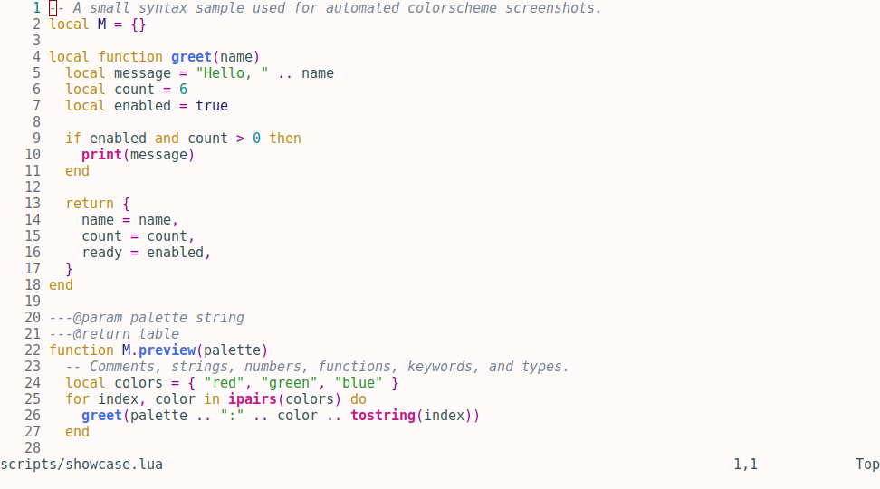

# findspot

Six colorschemes for Neovim, with matching palettes for Alacritty and Obsidian.



**Alexandria** · **Babylon** · **Knossos** · **Petra** · **Tikal** · **Troy**

More previews: [Alexandria](screenshots/alexandria.png) · [Babylon](screenshots/babylon.png) · [Knossos](screenshots/knossos.png) · [Petra](screenshots/petra.png) · [Tikal](screenshots/tikal.png) · [Troy](screenshots/troy.png)

## Neovim

Install with [lazy.nvim](https://github.com/folke/lazy.nvim):

```lua
{
  "1suo/findspot",
  lazy = false,
  priority = 1000,
  config = function()
    vim.cmd.colorscheme("findspot-alexandria")
  end,
}
```

Replace `alexandria` with `babylon`, `knossos`, `petra`, `tikal`, or `troy`.

## Other ports

- **Alacritty:** import a palette from `ports/alacritty/` in your `alacritty.toml`.
- **Obsidian:** copy a CSS file from `ports/obsidian/` into your vault's `.obsidian/snippets/`, then enable it under *Settings → Appearance → CSS snippets*.

These ports are experimental and have not had the same amount of in-app testing as the Neovim colorschemes. Feedback and screenshots are welcome.

## Development

Palette definitions live in `palettes/*.toml`. Generated files should not be edited directly.

```sh
lua scripts/generate.lua
```

This updates the Neovim, Alacritty, Obsidian, and composer outputs.

## Links

- [Palette composer](tools/composer.html)
- [Issues and feedback](https://github.com/1suo/findspot/issues)
