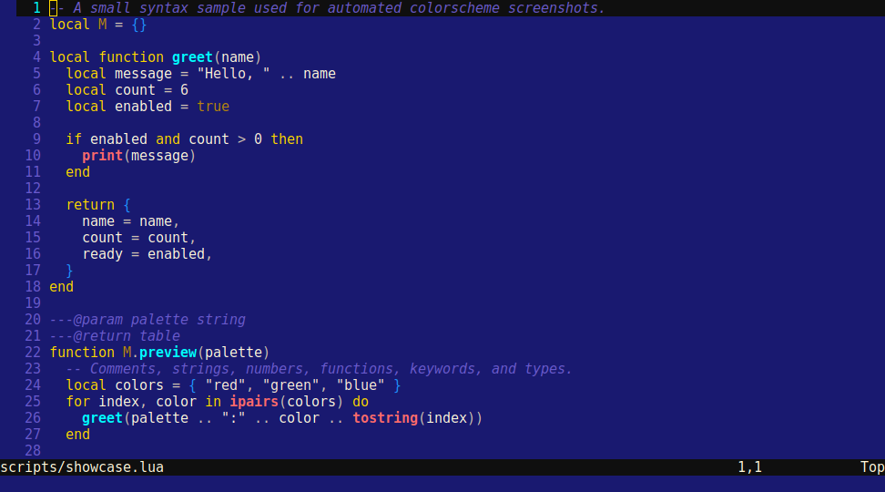
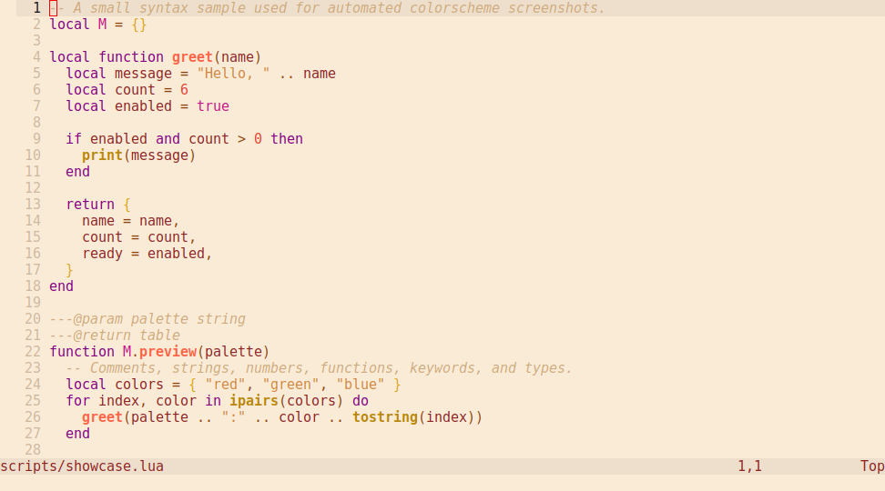
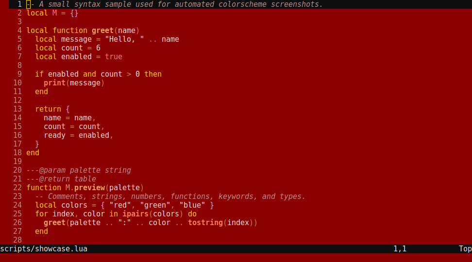
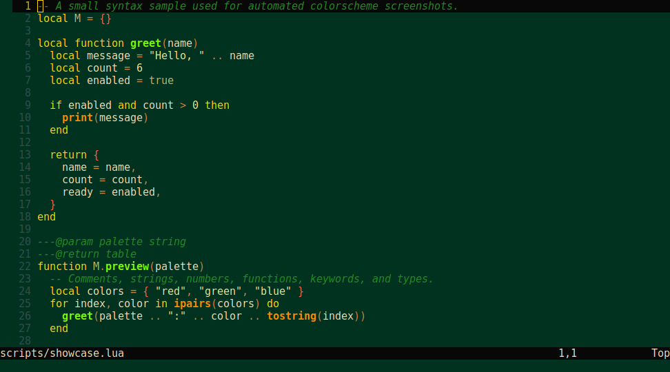
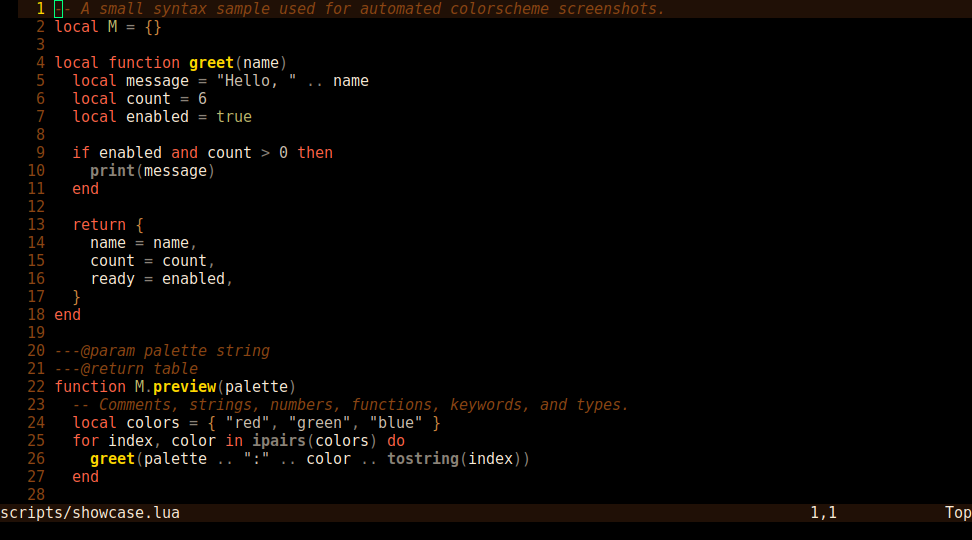

# findspot

A small family of opinionated, semantic color palettes for Neovim, Alacritty, and Obsidian.

The palettes are authored once in TOML and exported by `scripts/generate.lua`. The goal is a coherent, low-friction color language across editor, terminal, and notes—not a collection of unrelated theme files.


## Palettes

| Palette | Preview |
| --- | --- |
| Alexandria |  |
| Babylon |  |
| Knossos |  |
| Petra |  |
| Tikal |  |
| Troy |  |

Screenshots are rendered from the live palette composer in CI. They are illustrative previews, not screenshots of every target application.

## Supported ports

| Target | Format | Location | Status |
| --- | --- | --- | --- |
| Neovim | Lua colorschemes | [`colors/`](colors/) | Implemented; primary development target |
| Alacritty | TOML color imports | [`ports/alacritty/`](ports/alacritty/) | Generated; needs validation in Alacritty |
| Obsidian | CSS snippets | [`ports/obsidian/`](ports/obsidian/) | Generated; community-theme-level UI coverage is not claimed |

All generated files are outputs. Edit the TOML palettes, then regenerate.

## Installation

### Neovim

Add this repository to your plugin manager, for example with lazy.nvim:

```lua
{
  "1suo/findspot",
  lazy = false,
  priority = 1000,
  config = function()
    vim.cmd.colorscheme("findspot-alexandria")
  end,
}
```

Choose any installed colorscheme: `findspot-alexandria`, `findspot-babylon`, `findspot-knossos`, `findspot-petra`, `findspot-tikal`, or `findspot-troy`.

### Alacritty

Copy the palette file you want into your Alacritty configuration tree, then import it from `alacritty.toml`:

```toml
[general]
import = ["~/.config/alacritty/findspot-alexandria.toml"]
```

The files use Alacritty's `[colors.*]` TOML schema. Terminal ANSI colors are necessarily an approximation of the semantic editor palette.

### Obsidian

These are **CSS snippets**, not installable Obsidian community themes. For the selected palette:

1. Copy `ports/obsidian/<palette>.css` to `<vault>/.obsidian/snippets/`.
2. Open **Settings → Appearance → CSS snippets**.
3. Enable the snippet.
4. Set **Base color scheme** to the Light or Dark mode indicated in the generated file header.

The snippet styles Obsidian's shared CSS variables, Markdown preview, and CodeMirror editor tokens. Obsidian plugins and future app releases may introduce UI surfaces or selectors that need additional mapping. If something looks unthemed, please open an issue with an example and your Obsidian version.

## Palette schema

Each `palettes/*.toml` file defines semantic roles in these sections:

- `ui`: background, surface, foreground, muted text, borders, selection, cursor
- `accent`: primary and secondary accents
- `syntax`: language-token colors
- `status`: error, warning, success, info, hint
- `diff`: added, changed, removed

## Generate ports

Requirements: Lua 5.1+ (or LuaJIT) and a POSIX-like shell.

```sh
lua scripts/generate.lua
```

This regenerates `colors/`, `ports/alacritty/`, `ports/obsidian/`, and `tools/composer.html`. Do not edit generated files by hand.

## Contributing and validation

- Change the source palette in `palettes/`.
- Run the generator and include all generated diffs.
- Check Neovim, Alacritty, and Obsidian in their actual applications before describing a port as verified.
- Include app/version, OS, and a screenshot when reporting a rendering issue.

GitHub Actions regenerates the ports and refreshes the palette preview images on pushes to the default branch. The previews are produced from the composer, so they are useful for palette comparison but do not replace application-level testing.

## Discovery

Suggested GitHub repository topics: `neovim`, `neovim-colorscheme`, `vim-colorscheme`, `alacritty`, `alacritty-theme`, `obsidian`, `obsidian-theme`, `color-scheme`, `colorscheme`, `terminal-theme`.

If you use findspot with [Vim Colorschemes](https://vimcolorschemes.com/), please consider submitting the Neovim port there as a separate listing. The canonical source and installation instructions remain in this repository.

## License

No license file is currently present. Until a license is added, users should not assume the repository grants permission to redistribute or modify the code.
